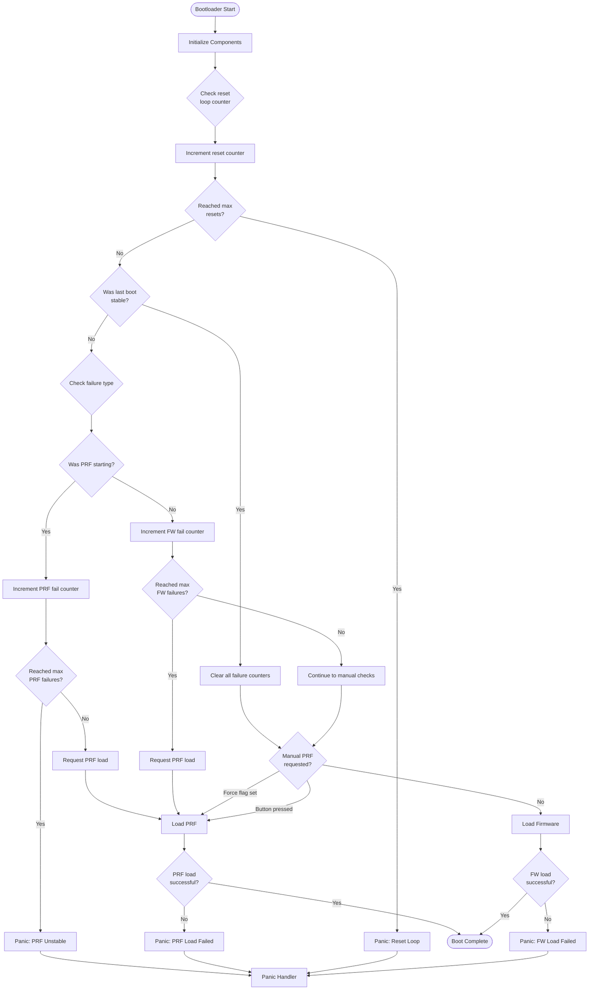

# PebbleOS bootloader

<a href="https://github.com/coredevices/pblboot/actions/workflows/build.yml?query=branch%3Amain">
  
</a>

This repository contains the PebbleOS bootloader.

## Getting Started

Before getting started, make sure you have a proper Zephyr development
environment. Follow the official
[Zephyr Getting Started Guide](https://docs.zephyrproject.org/latest/getting_started/index.html).

### Initialization

The first step is to initialize the workspace folder where `pblboot` and all
Zephyr modules will be cloned. Run the following command:

```shell
west init -m git@github.com:coredevices/pblboot --mr main pblboot
cd pblboot
west update
```

### Building and running

To build the bootloader, run the following command:

```shell
cd pblboot
west build -b $BOARD boot
```

where `$BOARD` is the target board, e.g. `pt2`.

Once you have built the bootloader, run the following command to flash it:

```shell
west flash
```

## Bootloader Design

The bootloader implements a robust boot sequence with failure recovery
mechanisms. The workflow handles firmware stability tracking, Pebble Recovery
Firmware (PRF) loading, and reset loop detection.

### Key Components

#### Retained Memory for State Tracking

The bootloader uses retained bootbit flags to track state across resets. The
implementation is platform-dependent.

#### Stability Tracking

The bootloader maintains counters to track firmware or PRF failures and the
number of consecutive resets:

- **Firmware Strikes**: Counts consecutive firmware boot failures
- **PRF Strikes**: Counts consecutive PRF boot failures
- **Reset Counter**: Counts consecutive resets

When firmware or PRF boots successfully, the reset counter is cleared.
Similarly, a stable flag is set after firmware or PRF has been running for a
while, so that the bootloader can reset the boot failure counters on the next
reboot.

#### PRF Loading

PRF can be triggered in several scenarios:

- **Automatic**: After reaching the maximum number of firmware failures
- **Manual**: Via button press during boot (Back+Up+Center for
  `CONFIG_PB_PRF_BUTTON_COMBO_TIME_MS`)
- **Forced**: Through bootbit flags (requested by firmware)
- **Recovery**: When PRF itself fails but hasn't reached the maximum number of
  failures

#### Failure Handling

XIP load failures enter the panic handler. Staged nRF load failures enter
non-expiring USB DFU; if DFU initialization fails, the panic handler runs.
The persistent dirty marker is retained on failed installation.

### Firmware Loading

XIP targets use two firmware slots and a separate PRF image. These images
execute in place; the bootloader selects a slot without copying its payload.

#### Image Header Format

Each XIP firmware image begins with a structured header:

```c
struct firmware_header {
    uint32_t magic;         // Magic number (0x96f3b83d)
    uint32_t header_length; // Size of header structure
    uint64_t priority;      // Boot priority (see below)
    uint32_t start_offset;  // Offset to actual firmware code
    uint32_t length;        // Firmware binary size
    uint32_t crc;           // CRC32-IEEE checksum
}
```

Note: the header itself is not covered by `crc`, which only protects the
firmware image starting at `start_offset`.

#### Boot Priority

The `priority` field is an unsigned 64-bit boot priority: between two valid
slots, the bootloader boots the one with the higher value. The bootloader
does not interpret the field beyond this comparison; the encoding below is a
convention of the build tooling.

The top byte (bits 63-56) selects a priority band:

| Band    | Bits 63-56 | Bits 55-32                    | Bits 31-0             |
|---------|------------|-------------------------------|-----------------------|
| Release | `0x01`     | Major, minor, patch (8b each) | Tag commit timestamp  |
| Dev     | `0x80`     | 0                             | Build wall-clock time |

- **Release**: builds from an exact release tag (`vX[.Y[.Z]]`, optionally
  `-betaN`/`-rcN`) encode the version so that a higher version always wins
  regardless of build order (releases may be built from branches out of
  order). The commit timestamp breaks ties within a version (e.g. beta vs
  final).
- **Dev**: any other build (untagged commit, dirty tree). Dev images outrank
  all release images, so a freshly flashed dev build always boots; among dev
  builds, the most recently built one wins.

Bands `0x02`-`0x7f` are reserved for future release encodings and
`0x81`-`0xff` for overrides that must outrank dev builds.

A consequence of the dev band is that a device running a dev image will not
boot an OTA-installed release until the dev slot is invalidated (e.g. by
entering PRF, which invalidates both slots, or by a flash erase).

#### Slot Selection Algorithm

The bootloader validates both slots and selects firmware based on:

1. **Validation**: Each slot is checked for:
   - Valid magic number and header structure
   - CRC32-IEEE checksum verification of the entire firmware image

2. **Selection Priority**:
   - If both slots are valid: Boot the slot with the higher boot priority
   - If only one slot is valid: Boot the valid slot
   - If no slots are valid: Attempt to load PRF


#### Cyberdeck EVT3 staged images

Cyberdeck uses one internal raw firmware image at `[0x8000, 0x100000)`;
the bootloader remains within the first 32 KiB. Normal, PRF and manufacturing
PRF binaries retain their raw `.bin`/`.hex` format and platform ID 22.

External SAFE occupies `[0, 0xff000)`, leaving MFG_INFO at
`[0xff000, 0x100000)`. Scratch occupies `[0x100000, 0x200000)`.
Both staging regions use a 12-byte little-endian description followed
immediately by raw firmware: `uint32_t description_length = 12`,
`uint32_t firmware_length`, `uint32_t checksum`. The checksum is CRC-32/IEEE
over the payload. The 28-byte XIP header is not accepted on this backend.
For USB DFU, wrap a raw image with
`tools/insert_firmware_descr.py INPUT OUTPUT` from the firmware checkout.
Commander recovery imaging accepts a raw image and wraps it itself.

Bit 1 requests scratch-to-internal installation. Bit 17 or the recovery
button combination selects SAFE first, even when bit 1 is pending. SAFE
must contain compatible recovery firmware; scratch/DFU accepts compatible
normal or recovery firmware. Bit 18 remains firmware-owned scratch-to-SAFE
promotion and is never installed into internal flash by the bootloader.
A new DFU transfer or non-append PutBytes firmware/recovery transfer cancels
stale bits 1 and 18. Direct FlashImaging erase/write requests do not.

Before internal erasure, the bootloader programs and reads back a dirty
word at external `0x1dd0000`, then sets retained bit 2. Only a complete
internal CRC verification permits erasing the 4-KiB BOOT_STATE page and
clearing bit 2. Lost retained RAM therefore does not hide an interrupted
installation. Dirty or invalid internal firmware falls back to SAFE; if
no verified image can boot, USB DFU remains available without an idle
timeout. A healthy explicit DFU entry may time out back to firmware.
After valid manifestation, USB stays serviced for the advertised poll timeout
plus two seconds before reboot, allowing the host to read the final status
and complete its USB reset.

#### Imaging, inspection, and recovery entry

- Use a raw Cyberdeck `.bin` with Commander’s interactive `image-firmware
  PATH [ADDRESS]` command (`image_firmware` in
  `tools/libs/pebble-commander/pebble/commander/_commands/imaging.py`). Its
  default input is `build/pebbleos.bin`; `ADDRESS` is optional and accepts
  hexadecimal notation. The command wraps the raw payload with the 12-byte
  description, checks that the wrapped image fits the queried SAFE region,
  then erases, writes, and compares a transport CRC. The host API is
  `connection.flash` (`FlashImaging`): `query_region_geometry(REGION_PRF)`,
  `erase(address, length)`, `write(address, data)`, `crc(address, length)`,
  and `finalize_region(REGION_PRF)`. `image-resources PACK` instead selects
  the unused system-resource bank; its default pack is
  `build/system_resources.pbpack`.
- USB DFU takes a *wrapped* `.dfu.bin`, not the raw `.bin`. From the firmware
  checkout, `tools/insert_firmware_descr.py INPUT.bin OUTPUT.dfu.bin` writes
  the little-endian `description_length`, `firmware_length`, and checksum
  before the payload. That checksum is CRC-32/IEEE of the raw payload, not
  the CRC of the entire wrapped file. The staged bootloader checks the
  description, size, vectors, platform/recovery metadata, and payload IEEE
  CRC at DFU manifestation before setting bit 1; after copying to internal
  flash it checks the internal payload CRC before clearing the dirty marker.
  Commander’s `crc(address, length)` and the read-only shell command
  `flash crc <addr> <len>` use the *legacy* transport CRC instead.
  Commander compares that legacy CRC against its host-side legacy CRC of the
  *wrapped* bytes; a match checks transfer integrity, not bootability or
  payload IEEE checksum validity. Do not compare it directly with the
  description checksum.
- `query_region_geometry(REGION_PRF)` reports `(region, address, length)`
  for `[SAFE_BEGIN, SAFE_END)`; it does **not** inspect the image. It also
  **unprotects SAFE**, so it is not a read-only probe. Region 2
  (`REGION_SYSTEM_RESOURCES`) reports the currently unused resource bank;
  unsupported regions return zero geometry. Erase/write and flash CRC
  operate on supplied addresses and are not constrained or validated by
  the preceding geometry query. `finalize_region(REGION_PRF)` re-protects
  SAFE; `finalize_region(REGION_SYSTEM_RESOURCES)` sets the new-resources
  boot bit. Neither finalization validates an image or commits an atomic
  transaction. SAFE protection is half-open: `[0, 0xff000)` is protected,
  while MFG_INFO begins at `0xff000` and is **not** part of SAFE.
- Commander’s recovery loader calls `finalize_region(REGION_PRF)` in a
  `finally` block after a successful geometry query, including when the
  fit check fails or the erase/write/CRC check fails. A failed geometry
  query happens *before* that block; a failed finalization can also replace
  the earlier error. The resources loader finalizes only after its transport
  CRC matches. Neither path provides rollback, and a failed write can leave
  a partial image. The `image-firmware` CLI also ignores the loader’s
  false result on a transport CRC mismatch; heed its mismatch report. To
  inspect SAFE, `flash dump <addr> <len>` reads flash without altering
  protection, but a dump or legacy CRC is not image validation. For
  external-flash BulkIO reads through normal firmware, limit each request
  to **240 bytes**: reads over 242 bytes assert with the MRU256 packet size;
  do not request a full flash chunk in one read. Independently validate
  the description, metadata, and IEEE CRC of the read-back *payload* before
  relying on an imaged SAFE copy.
- The read-only `version` command obtains SAFE metadata through
  `version_copy_recovery_fw_metadata()`, which checks description bounds
  and payload IEEE CRC before returning metadata. `version_is_prf_installed()`
  performs the same bounds/CRC check; neither API checks all loader
  compatibility rules. `version_copy_update_fw_metadata()` checks bounds
  but deliberately skips the scratch payload CRC. The underlying
  `firmware_storage_check_valid_firmware_description(start, end, desc, check_crc)`
  is in `fw/system/firmware_storage.c`. Promotion adds recovery/platform/footer
  identity checks; the loader also validates vectors before installation.
  DFU manifestation additionally requires the exact received byte count to
  match the description. Raw flash staging has no received-length record.
  **Do not use `flash validate` to validate an image.** It is a destructive
  flash-chip test that erases, writes patterns to, and finally erases the
  first scratch sector at `0x100000`; it destroys a pending staged image.
- Direct scratch staging uses wrapped bytes at `0x100000`, not a raw `.bin`.
  Before erasing scratch, deliberately clear old requests with
  `sys bootbit 1 0` and `sys bootbit 18 0`. Through `FlashImaging`, use
  `erase(0x100000, 0x100000)` and `write(0x100000, wrapped_image)`, then
  independently verify the stored description and payload. These raw
  operations neither validate the image nor schedule installation.
  For firmware-owned SAFE promotion, stage compatible recovery firmware,
  issue `sys bootbit 18 1`, then `sys reset`. Bit 1 instead requests
  scratch-to-internal installation on the next boot. Do not set either
  request before verification; scratch also holds firmware crash dumps.
- To enter bootloader USB DFU from running firmware, issue the shell command
  `sys dfu`: it sets the dedicated force-DFU bit and resets. Bit 18 is
  **not** a DFU-entry or imaging-finalize bit: the firmware’s PRF update
  service checks it to validate recovery firmware staged in scratch, copy
  it into SAFE, verify the copy, and restore SAFE protection; it clears
  bit 18 only after a verified copy. A healthy explicit DFU entry can time
  out and resume booting; when the internal image is dirty or invalid and
  no SAFE image boots, recovery USB DFU does **not** idle-timeout. DFU
  manifestation validates the staged
  image and schedules bit 1; it does not itself install the internal image.

### Bootloader Version Information

The bootloader stores its version at a fixed location in flash so that firmware
can read it at runtime without direct access to the bootloader binary. The
version structure is placed at the last 8 bytes of the boot partition.

#### Version Structure

```c
struct pb_version {
    uint32_t magic;    // 0x50425652 ("PBVR")
    uint8_t major;     // Major version number
    uint8_t minor;     // Minor version number
    uint8_t patch;     // Patch level
    uint8_t tweak;     // Tweak version
}
```

The `magic` field allows firmware to verify that valid version data is present.
The version numbers are automatically populated from the application version
defined in `boot/VERSION`.

On the nRF retained-register backend, word 2 also publishes the pblboot
repository HEAD commit timestamp, with the existing retained-block CRC.
Source archives must configure `-DPB_BUILD_TIMESTAMP=<decimal uint32>`
when Git metadata is unavailable; zero is not accepted. This timestamp
does not replace the PBVR semantic-version record or full build hash.

### Boot Sequence Overview


